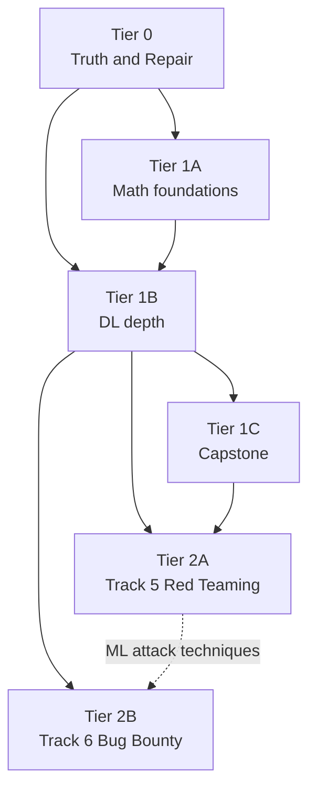

# ROADMAP — ML Programmer to ML Architect

**Status:** Active
**Last reviewed:** 2026-11-02
**Current position:** Tier 0.1 (measure) — Track 1 measured; A1/A3/A5 closed; Tracks 2–4 outstanding
**Supersedes:** `AUDIT_REPORT.md` (archived as evidence, not status)
**Authoritative for:** intent, sequencing, exit criteria

---

## 0. How to read this document

Five documents could claim to describe this repo's state. They are ranked. When two
disagree, the higher rank wins.

| Rank | File | Authority | Maintained by |
|---|---|---|---|
| 1 | `STATUS.md` | **Measured state** — per-notebook pass/fail, counts, coverage | Generated by `tools/status_report.py` from the sweep report; `tests/test_status_truth.py` re-counts the tree and fails on drift |
| 2 | `docs/ROADMAP.md` (this file) | **Intent** — tiers, phases, exit criteria, sequencing | Hand-edited |
| 3 | `docs/adr/ADR-00N` | **Decisions and why** | Hand-edited |
| 4 | `README.md` | **Orientation only** — no status claims, no counts | Hand-edited |
| 5 | `AUDIT_REPORT.md` | **Archived evidence** — dated snapshot, explicitly superseded | Frozen |

**Rule:** if `STATUS.md` and any other document disagree, `STATUS.md` wins.
Enforced by `tests/test_status_truth.py`, not by discipline.

**Why this exists:** before this document, `README.md` claimed Track 4 had 6 notebooks
(there are 12) and that the capstone was complete (it cannot start from a clean
checkout). `AUDIT_REPORT.md` claimed 32 notebooks (there are 38) and that notebooks
had "real outputs" (none do). Hand-maintained status rots. Generated status does not.

---

## 1. Purpose

This repo is a **learning aid** for the Skillsoft *ML Programmer to ML Architect*
Aspire Journey. It is not a portfolio to be completed for its own sake, and coverage
percentage is not the success metric.

The success metric is: **can the owner do the work without the notebook open?**

Context that shapes the plan:
- Owner has a red-team / offensive-security background.
- ML knowledge is self-taught through trial and error.
- The strongest existing asset is the agent tooling (retrieval MCP, skill lifecycle,
  model routing), not the course content.
- The weakest area is the mathematics, which is also the load-bearing prerequisite
  for everything downstream.

---

## 2. Current state

### 2.1 Structure

| Track | Directory | Notebooks | Parse | Execute | Outputs |
|---|---|---|---|---|---|
| 1 — Foundations | `track-01-ml-programmer/` | 7 | 7/7 | 7/7 | 0/7 |
| 2 — DL | `track-02-dl-programmer/` | 11 | 11/11 | 1/11 † | 0/11 |
| 3 — MLOps | `track-03-ml-engineer/` | 8 | 8/8 | 2/8 † | 0/8 |
| 4 — Architecture | `track-04-ml-architect/` | 12 | 12/12 | 8/12 † | 0/12 |
| Capstone | `capstone/` | — | — | 19/19 pytest | — |

† Stale: measured 2026-11-02 with `sklearn`, `torch`, `matplotlib` and `mlflow`
absent, and with `QUICK_MODE=1`. Not comparable with Track 1's row.

**No total is reported.** Only Track 1 has been measured in a working environment;
summing a valid row with three invalid ones would produce a number the repo cannot
produce, which §0.5 forbids. A total returns when Tracks 2–4 are re-measured (§2.5).

The `Execute` column is **not** a health measure. Track 1 was re-measured 2026-11-02
in a complete environment under `QUICK_MODE=1`; Tracks 2–4 still carry the earlier
sweep. Two of the three confounds are closed, quick mode is not — see §2.5. The
capstone column is its pytest suite, not its notebooks.

### 2.2 The central defect

**No notebook in the repo stores an output.** Every code cell is
`execution_count: null`, `outputs: []`.

The structural suite passes anyway — 128 tests, all green — because it validates
JSON, nbformat, and parseability, none of which require execution. The repo has a
gate that cannot see the problem it has. The status gate is now live, but it only
proves that `STATUS.md` agrees with the notebooks on disk; nothing in the suite
requires an output to exist.

Consequence: `tests/final_exam_grader.py` grades against stored outputs. With none
present it returns `NOT_EXECUTED` for every track, and CI only fails on `ERROR`, so
the step passes silently.

### 2.3 Contradictions

| Claim | Source | Reality |
|---|---|---|
| 32 notebooks | `AUDIT_REPORT.md` | 38 |
| Track 4 = 6 notebooks | `README.md`, `dashboard/app.py` | 12 |
| Capstone ✅ Complete | `README.md` L13 | ~60–70%, broken from clean checkout |
| Capstone 0% | `AUDIT_REPORT.md` | Stale — ~20 real source files exist |
| "Real outputs" | `AUDIT_REPORT.md` | Zero outputs repo-wide |
| Auto-graded checkpoints | `README.md` | Always `NOT_EXECUTED`; `final_exam` has no questions |
| Track 3 ✅ Complete | `README.md` L11 | 2/8 executed at the last sweep, under an incomplete environment; unverified since |
| nbval validation | `README.md` | 4 of 38 notebooks, `--nbval-lax` |
| Track 2 `06` template-only | `AUDIT_REPORT.md` | **Refuted** — full MoCo + MAE |
| Track 2 `11` 5-line stub | `AUDIT_REPORT.md` | **Refuted** — 34 cells, 1,826 lines |
| Diffusion concept-only | `AUDIT_REPORT.md` | **Inverted** — DDPM complete; VAE/GAN are prose-only |

### 2.4 Defects

Cell numbers in this section are 0-based indices into **code cells**: `track-01/05`
"cell 8" is the ninth code cell, at notebook cell index 16.

**Confirmed — measured (2026-11-02):**

| Location | Defect | Evidence |
|---|---|---|
| `capstone/data/raw/faqs.json` | Missing; gitignored by `.gitignore` L6 | `pytest capstone/tests -q` → 19 collected, 7 failed / 12 passed; all 7 failures are `FileNotFoundError` on this path |

**Confirmed — static (code and config):**

| Location | Defect |
|---|---|
| `requirements-assessment-heavy.txt` L3 | `torch>=2.0.0` unbounded — contradicts Maxwell guidance |

**Fixed (2026-11-02):**

| Location | Defect | Fix |
|---|---|---|
| `tests/run_assessment.py` L9–14 | `FAST_SUBSET` hardcoded 4 notebooks | Generated by `tools/execution_subset.py` (A2) |
| `tools/execution_sweep.py` | `first_error()` returned the traceback's `raise` line; every failure reported identically | Root-cause regex over the last exception header (§0.0b) |
| `.python-version` | Absent — local 3.14 vs Docker 3.10 vs CI 3.12 | Pinned to `3.12` (A12, §0.0) |
| `dashboard/app.py` | `st.columns(4)` + hardcoded `TRACKS` | Tracks discovered from `track-*/`; columns sized from the discovery (A1) |
| `capstone/data/raw/faqs.json` | Uncommittable under `.gitignore` `data/` | Root-anchored to `/data/`; corpus committed, suite 19/19 (A3) |
| `track-01/05` cell 8 | CYK tested set truthiness and stored rules as pairs, so the second non-terminal was never checked — `['a','a','a']` parsed as `True` | Recurrence over `(A, B, C)` triples; example grammar now has two true and two false cases |
| `track-01/07` cell 3 | Eval loop never incremented `steps` — dead bound, `Total steps: 1` always | `steps += 1` in the loop; executes in 6 steps |

**Refuted (measured 2026-11-02):**

| Claim | Evidence |
|---|---|
| `track-02/10` has `return` outside function → SyntaxError | `pytest tests/ -q` parses every code cell in it |
| `track-03/05` has a stray token | Same |
| `track-01/02` string-label `roc_auc_score` fails | `roc_auc_score(np.array(['<=50K','>50K',…]), proba)` returns normally — sklearn infers `pos_label` for binary labels. Cell 3 also ran unguarded in the sweep |

**Unverified (require execution):**

| Notebook | Suspected defect |
|---|---|
| `track-02/03` §4 | Teacher forcing is a bare markdown header |
| `track-02/04` | `trainer.train()` commented out |
| `track-02/05` | VAE is a plain autoencoder; GAN is prose-only |
| `track-02/07` | `results.eval_loss` is not a `TrainOutput` attribute |
| `track-03/02` | `fs` never defined; generated modules missing imports |
| `track-03/04` | Mock execution; "Component execution skipped" |
| `track-03/07` | Empty final code cell |
| `track-03/08` | Duplicated model-card cell; imports missing modules |
| `track-04/05` | Undefined `model`/`optimizer`/`criterion` |
| `track-04/06` | Invalid `prepare_model_for_kbit_training(target_modules=...)` |
| `capstone/serving/llm/local_provider.py` | `await` at module scope |
| `capstone/serving/llm/*_provider.py` | Missing `Optional` import; `null` used as a name |

### 2.5 Verification log

| Date | Check | Result | Effect |
|---|---|---|---|
| 2026-11-02 | `pytest tests/ -q` | 111 passed, 5.66s | Structural layer green; two syntax findings refuted |
| 2026-11-02 | `pytest capstone/tests -q` | Collection error: `sklearn`, `fastapi` missing | Capstone suite under-provisioned; 4 blockers unverified — **superseded below** |
| 2026-11-02 | `tools/execution_sweep.py` | 12/38, `QUICK_MODE=1`, 41m11s | **Not a valid health measure** — three confounds |
| 2026-11-02 | `uv pip install torch==2.14.1+cu126` | Timeout on `pypi.nvidia.com` | GPU path blocked at the time; **superseded below** |
| 2026-11-02 | `.venv/bin/python -m pytest tests/ -q` | 120 passed, 2 skipped, 6.18s | 11 tests added since the last run (122 collected); both skips are `test_status_truth.py` waiting on `STATUS.md` |
| 2026-11-02 | `execution_sweep.py --env-check` | `Environment OK` — nbformat, nbconvert, pandas, numpy, sklearn, matplotlib, torch, mlflow | Environment is no longer a confound |
| 2026-11-02 | `torch.cuda.is_available()` | `2.15.0+cu132` → `True` | **GPU is not blocked.** §0.4's CPU/GPU split no longer describes this machine |
| 2026-11-02 | `execution_sweep.py --only track-01-ml-programmer --timeout 120` | 7/7 PASS, report in `artifacts/execution_report.md` | Track 1 1/7 → 7/7; only `t1/02` guards cells with `QUICK_MODE` |
| 2026-11-02 | `pytest capstone/tests -q` | 19 collected, 7 failed / 12 passed, 3.30s | Suite is provisioned and collects; **every failure is `FileNotFoundError: capstone/data/raw/faqs.json`** — A3 is measured, not suspected |
| 2026-11-02 | `cyk_parse(cnf_rules, ['a','a','a'])` | `True` | Confirms the `t1/05` false accept on input the notebook never supplies |
| 2026-11-02 | `pytest capstone/tests -q` after committing the corpus | 19 passed | A3 closed: the suite runs from a clean checkout |
| 2026-11-02 | `pytest tests/ -q` after A1/A5 | 128 passed, 0 skipped | Status gate is live; dashboard discovery pinned |
| 2026-11-02 | `tools/status_report.py` | `STATUS.md`, 7/38 notebooks with a verdict | Track 1 measured; Tracks 2–4 honestly `not measured` |
| 2026-11-02 | `t1/05` executed after the CYK repair | `ab True, ba True, aa False, aba False` | False accepts gone; the old code returned `True` for `['a','a','a']` |
| 2026-11-02 | `t1/07` executed after the counter fix | `Total steps: 6`, `Reached goal: True` | Dead bound replaced; previously printed `1` for every path |

**The three sweep confounds:** incomplete environment (no `sklearn`, `torch`,
`matplotlib`, `mlflow`), `QUICK_MODE=1` (skips heavy paths), and broken error
extraction (every failure reports identically).

Two are now closed: the environment is complete and `first_error()` names root causes.
`QUICK_MODE=1` remains and still masks work — `t1/02` guards three of its six cells, so
its `PASS` says nothing about the unguarded hyperparameter search. A `PASS` under quick
mode means *the cells that ran* ran.

---

## 3. Tiers



| Tier | Content | Sessions | Gate |
|---|---|---|---|
| 0 | Truth, repair, environment | 4–6 | `STATUS.md` generated and enforced |
| 1A | Math foundations | 4–6 | Rebuild PCA/MLE/GD from scratch |
| 1B | DL depth | 6–8 | All Track 2 notebooks execute with outputs |
| 1C | Capstone | 4–6 | Clean checkout → tests pass → service starts |
| 2A | Track 5 — Red Teaming (13 notebooks) | 15–18 | Ethics gate passes; engagement delivered |
| 2B | Track 6 — Bug Bounty (10 notebooks) | 12–15 | Three valid findings reported |

Sessions are 2–3h focused blocks. Total ≈ 45–59.

---

## 4. Tier 0 — Truth and repair

Nothing else starts until this is done. The repo's metrics currently mislead, so
every downstream decision would otherwise rest on wrong numbers.

**Ownership:** 0.0 and 0.1 are the owner's — environment and measurement. The output of
0.1 is the input to 0.3, which is the agent's — repairs. 0.2, 0.4 and 0.5 are shared,
because each edits both the repo and the machine. A repair does not start before the
sweep that names it.

### 0.0 Runnable environment

**Status:** Done (2026-11-02). `.python-version` = `3.12`, `.venv` = 3.12.7,
`pytest tests/ -q` → 128 passed. The interpreter line now appears in `STATUS.md`,
generated rather than typed (§0.2, A5).

**Finding:** the assessment suite had never been collected in the development
environment. `pytest tests/ -q` failed with `ModuleNotFoundError: nbformat` under
Python 3.14, while the repo targets 3.10–3.12.

**Actions**
- Adopt `uv` for environment management.
- Pin the interpreter: `.python-version` containing `3.12`.
- Create `.venv` with `uv venv --python 3.12 .venv`.
- Install `requirements-assessment.txt` (minimal: pytest, nbval, nbformat, nbconvert,
  ipykernel, pandas, streamlit).

**Exit criteria**
- `pytest tests/ -q` collects and reports pass/fail.
- Interpreter version recorded in `STATUS.md`.

### 0.0b Fix the sweep before trusting it

**Status:** Done (2026-11-02). `first_error()` regexes the last exception header,
`classify()` emits `NEEDS_GPU`, the report is rewritten after every notebook, and
`--env-check` verifies the eight required imports and exits without sweeping.
`tests/test_execution_sweep.py` pins the parser and the gate.

**Finding:** `tools/execution_sweep.py` `first_error()` (L36–41) returns the first
line containing "Error", which in an nbconvert traceback is always
`raise CellExecutionError...`. Every failure reports identically, so the report
cannot distinguish a missing dependency from a broken notebook.

**Actions**
- Replace `first_error()` with a regex returning the last
  `<ExceptionClass>: <message>` line.
- Add a `NEEDS_GPU` status for `CellTimeoutError`, distinct from `FAIL`.
- Write the report incrementally so Ctrl-C preserves partial results.
- Add an `--env-check` mode that verifies required imports before running.

**Exit criteria**
- A sweep report where each failure names its actual exception class.
- Interrupting a sweep leaves a usable report.

### 0.1 Measure

**Status:** Track 1 measured — 7/7, quick mode. The capstone suite is measured
(19 collected, 7 failed / 12 passed; all failures trace to `faqs.json`). Tracks 2–4
remain outstanding, and nothing has been measured with `QUICK_MODE=0`.

**Actions**
- `uv pip install --python .venv/bin/python -r requirements-assessment-heavy.txt`
  (already installed on this machine — see §0.4).
- `pytest capstone/tests -q` ✔ done
- `tools/execution_sweep.py --only track-01-ml-programmer --timeout 120` ✔ done
- The full sweep, Tracks 2–4, with and without quick mode.

**Exit criteria**
- A per-notebook verdict list with exception classes, superseding `README.md` and
  `AUDIT_REPORT.md`.

### 0.2 Make failure visible

**Status:** Done for the mechanism (2026-11-02). `tools/status_report.py` generates
`STATUS.md`, `tests/test_status_truth.py` runs, `final_exam_grader.py` exits non-zero
for `NOT_EXECUTED`/`FAIL`/`ERROR`, and CI explicitly scopes itself (workflow name
plus a generated subset from A2). Still open: checkpoint expectations are
placeholders, so the grader runs report-only until **A13** calibrates them.

**Actions**
- `final_exam_grader.py` fails on `NOT_EXECUTED` instead of passing. ✔ done
- CI executes the generated subset, names itself scoped, and gates on that
  subset's nbval execution. ✔ done
- Generate `STATUS.md` from measured results. ✔ done

**Exit criteria**
- A red build is possible: a broken subset notebook fails validation/nbval.
- Deliberately breaking one notebook is covered by `tests/test_notebooks.py`
  (parse gate) and the nbval step; the grader is calibrated under A13.

### 0.3 Unbreak

**Actions** — in this order:
1. Missing data: `faqs.json` (see A3)
2. Capstone imports: `local_provider.py`, provider `Optional`, `mock_provider` `null`
3. Runtime bugs: `t1/02` (unmeasured under quick mode), `t2/07`, `t4/05`, `t4/06`
4. Stubs: `t3/04`, `t3/07`, `t3/08`, `t2/03` §4
5. Depth: `t2/05` VAE/GAN (see Tier 1B)

**Exit criteria**
- Sweep green, or every remaining failure carries `@pytest.mark.quarantined` with a
  `reason` (A6), or is classified `NEEDS_GPU`.

### 0.4 Environment: CI is CPU, this machine is GPU

`execution_sweep.py` has **no device selection**. It runs `jupyter nbconvert` under
`sys.executable`, so the environment that invokes it decides the backend. The two
paths below are therefore two *environments*, not two sweep flags.

| Environment | Use | Install |
|---|---|---|
| **CI — CPU** | `pytest tests/`, structural checks, the fast subset | `pip install --extra-index-url https://download.pytorch.org/whl/cpu -r requirements-ci.txt -r requirements-assessment.txt` |
| **Local — GPU** | Every sweep on this machine, including notebooks that time out on CPU | Already installed: `torch 2.15.0+cu132`, `torch.cuda.is_available() → True`. Do not re-pin to cu126; the older wheel is what previously timed out on `pypi.nvidia.com` |

`torch` stays unpinned in `requirements-assessment-heavy.txt` (`torch>=2.0.0`), so a
fresh install can silently land on a different build than the one measured here —
that is A9, and it is why the version is recorded above rather than assumed.

**Also required**
- Fix `Dockerfile` `gpu-dev` to copy `requirements.txt`.
- Add `streamlit` to the dashboard image.
- Regenerate locks from one source; delete variants that contradict each other
  (all three committed locks were compiled under Python 3.11).
- Align the interpreter: `Dockerfile` pins Python 3.10, CI and `.python-version` say 3.12.

**Exit criteria**
- CI green on one documented combination.
- `docker compose up -d dashboard` starts.

### 0.5 Reconcile documents

**Actions**
- Delete hand-maintained status tables from `README.md`.
- Freeze `AUDIT_REPORT.md` with a header marking it superseded.
- Dashboard reads `STATUS.md` rather than hardcoded counts.

**Exit criteria**
- No document claims a number the repo cannot produce.
- `tests/test_status_truth.py` passes.

---

## 5. Tier 1 — Core journey depth

Ordered by the owner's learning gap, not by audit severity.

### 1A — Math foundations (4–6 sessions)

Target: `track-01/04_mathematical_foundations.ipynb`.

It already derives PCA/SVD/MLE from first principles. What is missing:

| Add | Why |
|---|---|
| Calculus derivation of gradients | Currently hard-coded; you cannot debug a loop you cannot differentiate |
| SGD, momentum, Adam | Vanilla GD is the only optimizer present |
| Multivariate Gaussian, covariance, conditioning | Prerequisite for PCA intuition and numerical stability |
| Entropy, KL divergence | Underpins VAE, distillation, and most losses |
| Linear regression derived end-to-end | The canonical worked example |
| Fix Exercise 4 | Code is trapped inside a markdown cell and never runs |

**Exit criteria**
- Rebuild PCA, MLE, and gradient descent in a blank file without reference.
- Every section has stored outputs.

### 1B — DL depth (6–8 sessions)

| Notebook | Fix | Priority |
|---|---|---|
| `t2/05_generative` | VAE is a plain autoencoder — no μ/logσ², no reparameterization, no KL. GAN is prose-only | Highest |
| `t2/03_rnn_seq` | §4 teacher forcing is an empty header; Seq2Seq never trained | High |
| `t2/04_transformers` | `trainer.train()` commented out | High |
| `t2/07_nlp_finetune` | `results.eval_loss` bug; synthetic 5-example set; no held-out metric | Medium |
| `t2/10_recommender` | Verify after sweep; suspected defect refuted statically | Medium |
| `t3/02`, `t3/06` | Replace synthetic data with real — synthetic cannot exhibit the leakage and drift being taught | Medium |

**Exit criteria**
- All Track 2 notebooks execute with stored outputs.
- Each has a predict-then-verify section (§8.2).

### 1C — Capstone (4–6 sessions)

**Actions**
- Fix integration (largely covered by 0.3).
- Add the security layer: multi-tenant isolation, endpoint abuse, supply-chain signing.

**Exit criteria**
- Clean checkout → `pytest capstone/tests` green → service starts → `/health` returns 200.

---

## 6. Tier 2 — Security tracks

Both tracks are **bonus**. They reuse Tracks 1–4 as substrates rather than
re-teaching ML. Both are gated by the ethics test in §8.3.

### 2A — Track 5: Red Teaming

`track-05-red-teaming/` — 13 notebooks, five modules.

| Module | # | Notebook | Deliverable |
|---|---|---|---|
| A — Engagement craft | 01 | `01_engagement_fundamentals` | Scope + threat model |
| | 02 | `02_threat_emulation` | Emulation plan |
| B — Digital operations | 03 | `03_recon_and_attack_surface` | Attack surface map |
| | 04 | `04_initial_access_and_opsec` | Access + OPSEC assessment |
| | 05 | `05_post_exploitation` | Lateral movement report |
| | 06 | `06_c2_and_infrastructure` | C2 design + detection analysis |
| C — Detection & ML | 07 | `07_detection_engineering` | Detection coverage report |
| | 08 | `08_adversarial_ml_offense` | Evasion report |
| | 09 | `09_model_extraction_and_agents` | Extraction + agent exploitation report |
| D — Physical operations | 10 | `10_physical_recon_and_osint` | Facility recon package |
| | 11 | `11_surveillance_and_path_planning` | Coverage map + route analysis |
| | 12 | `12_access_control_analytics` | Access analytics report |
| E — Capstone | 13 | `13_red_team_capstone` | Engagement package |

**Why physical lives here and not in its own tier:** physical is a red team
discipline, shares the ROE/engagement framing, and the ML content supports three
notebooks — below the ~8–10 needed to justify a tier's scaffolding. Bug bounty has
no meaningful physical analogue, so Track 6 is the wrong home.

**Physical module scope:** ML applies to the *analysis* phases, not execution.
Imagery recon, camera coverage and path planning, access-log analytics, and RF
localization are the four defensible applications. Lock picking, RFID cloning, and
tailgating are out of scope — they are not ML problems.

**Exit criteria**
- All 13 notebooks pass the ethics gate.
- Capstone engagement delivered against a local lab.

### 2B — Track 6: Bug Bounty

`track-06-bug-bounty/` — 10 notebooks, four modules.

| Module | # | Notebook | Deliverable |
|---|---|---|---|
| A — Program craft | 01 | `01_program_mechanics` | Program selection analysis |
| | 02 | `02_recon_at_scale` | Recon pipeline |
| B — Bug classes | 03 | `03_web_and_api_classes` | Finding set |
| | 04 | `04_cloud_and_infra_classes` | Finding set |
| | 05 | `05_ml_endpoints_as_targets` | ML finding set |
| C — ML-assisted workflow | 06 | `06_triage_and_false_positives` | Triage model |
| | 07 | `07_duplicate_avoidance` | Dedup model + analysis |
| | 08 | `08_severity_scoring` | Scoring model |
| D — Reporting | 09 | `09_report_writing` | Report portfolio |
| | 10 | `10_disclosure_and_capstone` | Disclosure package |

**Split rationale:** red teaming and bug bounty differ on authorization model,
target count, stealth requirement, success metric, deliverable, and failure mode.
Only recon, exploitation, validation, and reporting are shared. A combined track
would teach neither discipline's constraints properly.

**Exit criteria**
- Three valid findings reported against lab targets, each with a complete report.

---

## 7. Amendments

A1–A3 are blockers: the plan breaks or is unmeasurable without them. A8 was a
blocker and is closed; it stays in the table so the reason isn't re-litigated.

| # | Amendment | Evidence | Severity | Status |
|---|---|---|---|---|
| **A1** | Refactor dashboard to `st.columns(len(TRACKS))`; derive `TRACKS` from the filesystem | `dashboard/app.py` L54, L58–59 → `IndexError` on the 5th track | **Blocker** | **Done** — `discover_tracks()`, columns sized from the discovery |
| **A2** | Generate the execution subset instead of hardcoding it | `tests/run_assessment.py` L9–14 `FAST_SUBSET` lists 4 notebooks | **Blocker** | **Done** — `tools/execution_subset.py`; derived from `STATUS.md` + checkpoint order |
| **A3** | Make `faqs.json` committable | `.gitignore` L6 `data/`, L7 `track-*/data/`. Prefer moving fixtures to `capstone/tests/fixtures/`. **Measured:** 7 of 19 capstone tests fail on its absence | **Blocker** | Open |
| **A4** | Create this file as the canonical plan | Plan previously existed only in conversation | High | **Done** — this file |
| **A5** | Specify the `STATUS.md` generator | No generator existed; `execution_sweep.py` writes only `artifacts/execution_report.md` (which `.gitignore` L5 ignores) | High | **Done** — `tools/status_report.py`, `STATUS.md`, truth test live |
| **A6** | Define quarantine | `@pytest.mark.quarantined(reason=...)`; fail if a quarantined notebook has been green for two runs | Medium | Open |
| **A7** | Clarify the skills freeze | Freeze means no new *infrastructure*; a skill for a new track is content and is allowed | Medium | Open |
| **A8** | Fix `first_error()` in the sweep | Returned the traceback's `raise` line; every failure reported identically | **Blocker** | **Done** — root-cause regex, `tests/test_execution_sweep.py` |
| **A9** | Pin or document torch in the heavy requirements | `requirements-assessment-heavy.txt` L3 `torch>=2.0.0` lets a fresh install land on any build; measured here as `2.15.0+cu132` | High | Open |
| **A10** | Document a CPU triage path | Was: GPU install times out on `pypi.nvidia.com` | High | **Superseded** — GPU works on this machine; §0.4 now documents CI-CPU vs local-GPU |
| **A11** | Add `NEEDS_GPU` as a sweep status | `CellTimeoutError` is a resource classification, not a defect | Medium | **Done** — `classify()` |
| **A12** | Add `.python-version` | Local 3.14 vs Dockerfile 3.10 vs CI 3.12 vs locks 3.11 | Medium | **Done** — `3.12` |
| **A13** | Calibrate checkpoint expectations to real outputs | `checkpoints/track_01*.json` asks for `float 0-1`, `tuple`, `SAT/UNSAT`; measured outputs score 0/14 | **Blocker** | Open — grader is report-only until this closes |

### Wiring required when tracks are added

| File | Change |
|---|---|
| `tests/test_notebooks.py` | Add both tracks to `TRACKS` and `MINIMUMS` (13 and 10) — **only after notebooks exist** |
| `tests/test_offensive_scope.py` | New; globs both offensive tracks; enforces the authorization cell |
| `checkpoints/track_05_red_teaming.json` | 13 checkpoints, 26 questions, final exam 25q/60min/0.75 |
| `checkpoints/track_06_bug_bounty.json` | 10 checkpoints, 20 questions, final exam 25q/60min/0.75 |
| `dashboard/app.py` | Add both tracks (see A1) |
| `README.md` | Two new rows; fix the stale Track 4 count |
| `requirements-redteam.txt` | `torchattacks`, `adversarial-robustness-toolbox`, `captum`, `garak`, `networkx`, `faker` |
| `labs/docker-compose.yml` | Juice Shop, DVWA, vulhub — localhost-bound |
| `.opencode/skills/authorized-testing/SKILL.md` | Fires in both offensive tracks; enforces scope cell; refuses live targets |

**Checkpoint schema is enforced.** `tests/run_assessment.py` L39–54 asserts `track`,
`checkpoints`, `final_exam`, and per-checkpoint `id`/`notebook`/`skills`/`questions`.
New checkpoint files must match exactly or assessment fails at step 2/4.

---

## 8. Conventions

### 8.1 Notebook standard

Every notebook, in every track:

1. Opens with a title cell stating the objective and the deliverable.
2. Has **stored outputs** for every code cell. No exceptions.
3. Ends with a **Verify** section containing a command or assertion that proves it ran.
4. Uses real data where the lesson is about data, and synthetic data only where the
   lesson is about method.

### 8.2 Predict-then-verify

Before each substantive code cell, a markdown cell states what the output is expected
to be and why. The delta between prediction and output is the lesson. This is the
highest-value change in the plan and it costs nothing.

### 8.3 Ethics gate (offensive tracks only)

Every notebook in `track-05-*` and `track-06-*` must contain an `## Authorization`
markdown cell declaring:

- the target (local container, synthetic corpus, or self-built model)
- the authorization basis (self-owned, lab, or program scope)
- the blast radius

Rules:
- Targets are localhost or containerized only. No live scanning, no real domains,
  no public IPs.
- No real personal data. Synthetic corpora only.
- Findings against real programs follow that program's disclosure policy.

Enforced by `tests/test_offensive_scope.py`. If a notebook cannot state its
authorization, it does not run.

### 8.4 Quarantine

A notebook that cannot be repaired immediately is marked:

```python
@pytest.mark.quarantined(reason="missing faqs.json fixture; see A3")
```

A quarantine entry without a `reason` fails. A quarantined notebook that has passed
for two consecutive runs fails, so quarantine cannot become permanent.

### 8.5 Sweep statuses

| Status | Meaning | Action |
|---|---|---|
| `PASS` | Executed cleanly | None — but under `QUICK_MODE=1` it means only *the cells that ran* ran |
| `FAIL` | Raised an exception | Fix the notebook |
| `NEEDS_GPU` | `CellTimeoutError` — the cell exceeded its budget. **Not a claim that hardware is missing.** This machine has a CUDA build, so a timeout is as likely to be slow code as a missing device | Raise the timeout and re-run; if it still times out, treat as `FAIL` and profile |
| `QUARANTINED` | Known-broken, reason recorded | **Not yet emitted** — `classify()` returns only `PASS`/`FAIL`/`NEEDS_GPU`. Implementing it is A6 |

---

## 9. Scope control

Twenty-three security notebooks is a real detour from the journey. Two guardrails:

### Minimum viable path (6 + 6)

**Track 5:** 01, 02, 03, 07, 08, 09
**Track 6:** 01, 02, 06, 07, 08, 09

Covers engagement craft, recon, detection/evasion, adversarial ML, triage, dedup,
severity, and reporting — the parts that transfer to actual work.

### Sequencing

Do Tier 0 and 1A first. Not because the security tracks depend on them technically,
but because the mathematics is the thing that cannot be shortcut, and the security
tracks are enjoyable enough to become displacement activity. Build them *after*
`t1/04` is solid, and treat them as the reward.

---

## 10. Maintenance

| Cadence | Action |
|---|---|
| Every assessment run | `STATUS.md` regenerated by `tools/status_report.py`; `tests/test_status_truth.py` fails on drift |
| Monthly | `tools/skills-lint.sh`; review quarantine list |
| Quarterly | Archive review; re-derive rather than resurrect retired skills |
| On tier completion | Update §3 table and this document's `Last reviewed` date |
| On any merge | One plan file. Drafts are merged into this file and deleted, never kept alongside — a case-only duplicate collides on case-insensitive checkouts |

### Change log

| Date | Change |
|---|---|
| 2026-11-02 | Initial roadmap. Consolidates the static audit, the Tier 0–2 plan, the Track 5/6 split, the physical module, and amendments A1–A12. |
| 2026-11-02 | Added §2.5 verification log. Refuted two syntax findings via `pytest`. Recorded the sweep's three confounds and the `pypi.nvidia.com` timeout. Added A8–A12. |
| 2026-11-02 | Merged `docs/Roadmap.md` into this file and deleted it. Kept: the Tier 0 ownership split (§4). Dropped as redundant: the paste-and-run blocks (`.python-version`, `tests/test_status_truth.py`, the patched sweep — all applied, and the embedded sweep copy was already stale) and the draft-change table, which this log supersedes. Also recorded 0.0/0.0b completion, the 7/7 Track 1 sweep, the unblocked GPU path, and the two silent Track 1 defects. |
| 2026-11-02 | Review pass, re-verified against the tree. Removed the mixed-environment `18/38` total (§2.1) — only Track 1 is comparable, so no total is published. Rewrote §0.4 around the measured environment (CI-CPU, local GPU `2.15.0+cu132`) after it still prescribed a cu126 pin and a nonexistent sweep default. Moved `faqs.json` to measured evidence: `pytest capstone/tests` now collects 19 and fails 7, all on that file. Corrected the `t1/05` entry — the rule schema is pairs, there is no `C`, and the false accept is `['a','a','a']`, not "True either way". Resolved the §0/A5 conflict over who generates `STATUS.md`. Added a status column to §7 (A4/A8/A11/A12 done, A10 superseded). Defined `NEEDS_GPU` and marked `QUARANTINED` unimplemented in §8.5. |
| 2026-11-02 | Tier 0 execution. A3: root-anchored `/data/` in `.gitignore` and committed `capstone/data/raw/faqs.json` (9 FAQs) — capstone suite 12/19 → 19/19. A1: dashboard derives tracks from `track-*/` and sizes its columns from the discovery; the stale Track 4 = 6 denominator corrected. A5: `tools/status_report.py` generates `STATUS.md` from the sweep report, so `tests/test_status_truth.py` runs instead of skipping. 128 tests, 0 skipped. |
| 2026-11-02 | Repairs the measurement named: `track-01/05` CYK rewritten over `(A, B, C)` triples with a grammar that has negative cases; `track-01/07` eval loop now counts steps. Pre-commit hooks no longer run ruff on notebooks and nbstripout keeps cell ids — both were rewriting whole notebooks per commit. |
